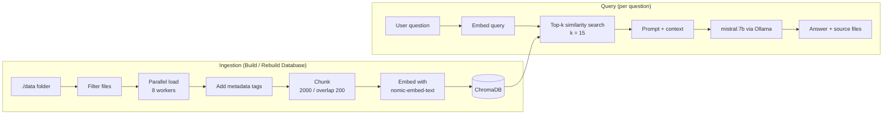

# SimpleRAG

A local, privacy-first Retrieval-Augmented Generation (RAG) chat app. Point it at a folder of configuration files and documents, build a vector index, and ask questions in natural language. Everything runs on your machine: no API keys and no data leaves the host.

**Stack:** Python · Streamlit · LangChain · ChromaDB · Ollama (`nomic-embed-text` for embeddings, `mistral:7b` for generation)

> This repository contains code only. It ships with no data and no pre-built index. Bring your own documents.

## How it works



### Ingestion
1. Recursively scans `./data`.
2. Skips files over 2 MB and CSV files whose name contains `usage` (large metric dumps).
3. Loads `.yaml`, `.yml`, `.txt`, `.log`, `.csv`, `.pdf` and `.md` files in parallel, with per-file error handling so one bad file never aborts the build.
4. Prepends `SOURCE_FILE` and `TARGET_ENVIRONMENT` tags to each document and stores them in the chunk metadata. The environment name is read from a `/<ENV>/` path segment, so the same question can be answered across several environments.
5. Splits text with `RecursiveCharacterTextSplitter` (chunk size 2000, overlap 200).
6. Embeds in batches of 100 and persists to `./chroma_db_dynamic`.

### Query
The retriever returns the 15 most similar chunks. They are injected into a prompt and sent to the local LLM, which answers (often as a Markdown table) and lists the source files.

## Files

| File | Purpose |
|---|---|
| `app.py` | Streamlit app: ingestion, retrieval chain and chat UI |
| `check_db.py` | Inspect the vector store (document counts and metadata) |
| `startApp.sh` | Launches the app: `streamlit run app.py` |

## Run it

Prerequisites: Python 3.11+ and [Ollama](https://ollama.com) installed and running.

```bash
# 1. Models
ollama pull nomic-embed-text
ollama pull mistral:7b

# 2. Dependencies (inferred from the imports in app.py)
pip install streamlit langchain langchain-community langchain-chroma \
            langchain-ollama langchain-text-splitters chromadb pypdf unstructured

# 3. Add your own documents under ./data (optionally one sub-folder per environment)
mkdir -p data/env-a data/env-b

# 4. Start
streamlit run app.py
```

Then click **Build / Rebuild Database** in the sidebar and start asking questions.

## Configuration

Set at the top of `app.py`:

| Setting | Default | Meaning |
|---|---|---|
| `DATA_DIR` | `./data` | Folder to index |
| `CHROMA_PATH` | `./chroma_db_dynamic` | Where the vector store is saved |
| `MAX_FILE_SIZE_BYTES` | 2 MB | Larger files are skipped |
| `chunk_size` / `chunk_overlap` | 2000 / 200 | Text splitting |
| retriever `k` | 15 | Chunks passed to the LLM |
| embedding model | `nomic-embed-text` | Ollama embedding model |
| LLM | `mistral:7b` | Ollama generation model |

## Data and privacy

`data/`, `chroma_db*/` and `rag_build.log` are git-ignored on purpose. Index only content you are allowed to use. Never commit the vector store: it contains embedded copies of your source documents.

## Part of

[sangramkesharidash.github.io](https://sangramkesharidash.github.io) · a series on RAG and agentic AI: SimpleRAG → GraphRAG → AgenticRAG → AgenticObservability.
